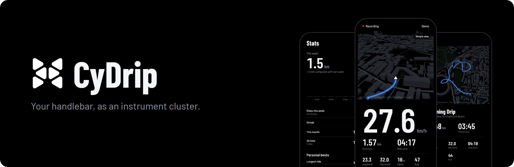
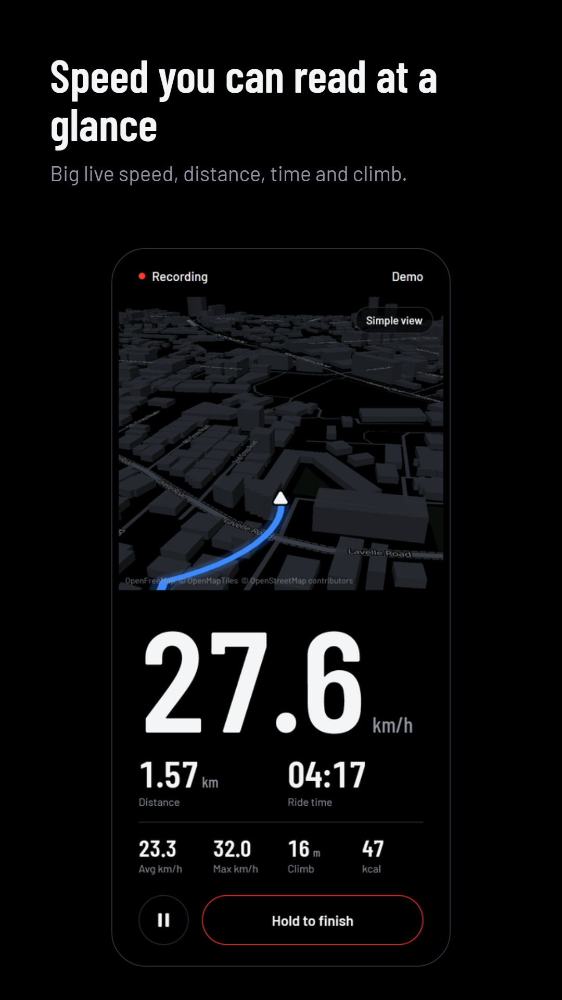
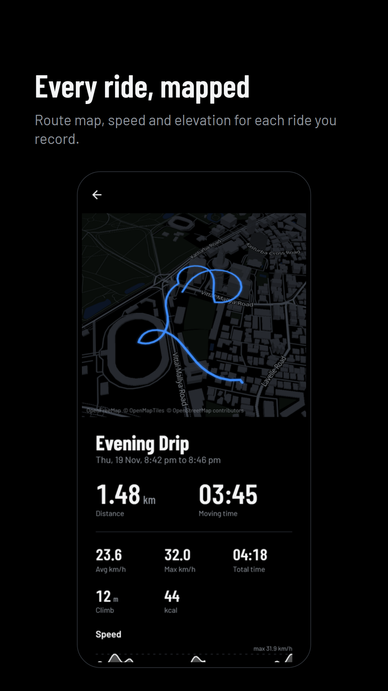
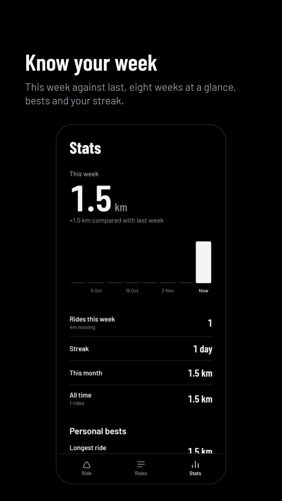

<p align="center">
  
</p>

# CyDrip

Open-source ride and run tracker for the phone on your handlebar. Built and maintained by
**Webrizen AI Labs**.

No account, no ads, no tracking. Your rides stay on your phone.

<p align="center">
  
  
  
</p>

## Features

- **Ride dashboard** — huge live speed, distance, time, average/max speed, climb and calories,
  readable at a glance on a handlebar mount. The screen stays on, tabs hide while riding, and
  finishing is press-and-hold so a bump can't end the ride. Portrait or landscape.
- **3D street map** — a tilted map that follows you, with real streets and 3D buildings from
  OpenStreetMap. Switch to **Simple view** (a grid road view) when you're out of data.
- **Running** — pick Ride or Run before you start. Runs show pace (min/km), get per-km splits, and
  don't keep the screen on, so the phone can stay in your pocket.
- **Background recording** — GPS keeps recording with the screen off or another app open.
  Auto-pause at stops.
- **Snap** — after every activity, a share image of your route and your numbers. Four styles (Line,
  Poster, Floor, and a transparent Sticker for your own photos), story or square.
- **Activity and stats** — every ride and run with its map, speed and elevation charts; this week
  vs last week, an 8-week chart, totals, personal bests and your streak.

## Install

Download the latest APK from [Releases](https://github.com/webrizen-ai-labs-pvt-ltd/cydrip/releases)
and open it on your Android phone. You may need to allow "Install unknown apps" for your browser.

On first launch:

- Allow location **While using the app**. "All the time" isn't needed; the recording notification
  keeps GPS running.
- Allow notifications so you can see when a ride is recording.
- If your phone stops apps in the background, set CyDrip's battery usage to **Unrestricted**.

## Build from source

CyDrip is an [Expo](https://expo.dev) (SDK 58) app using Expo Router, written in TypeScript.

```bash
npm install
npx expo start --web
```

The browser preview has no GPS; tap **Try a demo ride** on the start screen to see every screen with
simulated data.

To run on an Android phone you need a development build, because GPS recording and the map use
native code:

```bash
npx eas-cli@latest build --platform android --profile development
npx expo start
```

For a standalone APK, use `--profile preview`. Rebuild whenever a library with native code is added.

## Project layout

```
src/
  app/            Screens (Expo Router)
    (tabs)/       Go (start + dashboard), Activity, Stats
    ride/[id]     Activity detail
    snap/[id]     Share image
  components/     UI building blocks, road view, snap card
  lib/            GPS tracker, storage, formatting, settings
  map/            3D street map (MapLibre on Android, maplibre-gl on web) and its style
  brand/          The CyDrip mark as vector paths
  theme.ts        Colours, fonts and spacing
assets/images/    App icon, adaptive icon, splash, notification icon
brand/            Banners, screenshots, social images, sticker
scripts/          build-icons.mjs regenerates assets/images from the mark
```

## Scripts

| Command | What it does |
| --- | --- |
| `npm start` | Start the dev server |
| `npm run typecheck` | Type-check with TypeScript |
| `npm run lint` | Lint with ESLint |
| `npm run icons` | Regenerate app icons from `src/brand/logo.ts` |

## Contributing

Issues and pull requests are welcome. See [CONTRIBUTING.md](CONTRIBUTING.md).

## Credits

- Map data © [OpenStreetMap](https://www.openstreetmap.org/copyright) contributors, tiles by
  [OpenFreeMap](https://openfreemap.org) and OpenMapTiles.
- Typeface: [Barlow](https://fonts.google.com/specimen/Barlow), SIL Open Font License.

## License

MIT © Webrizen. See [LICENSE](LICENSE).
